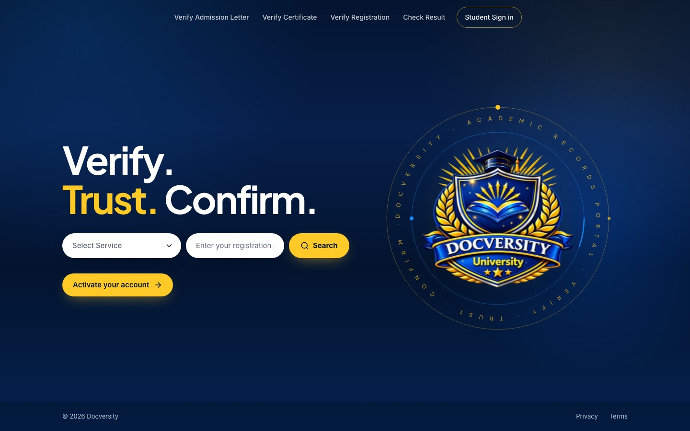
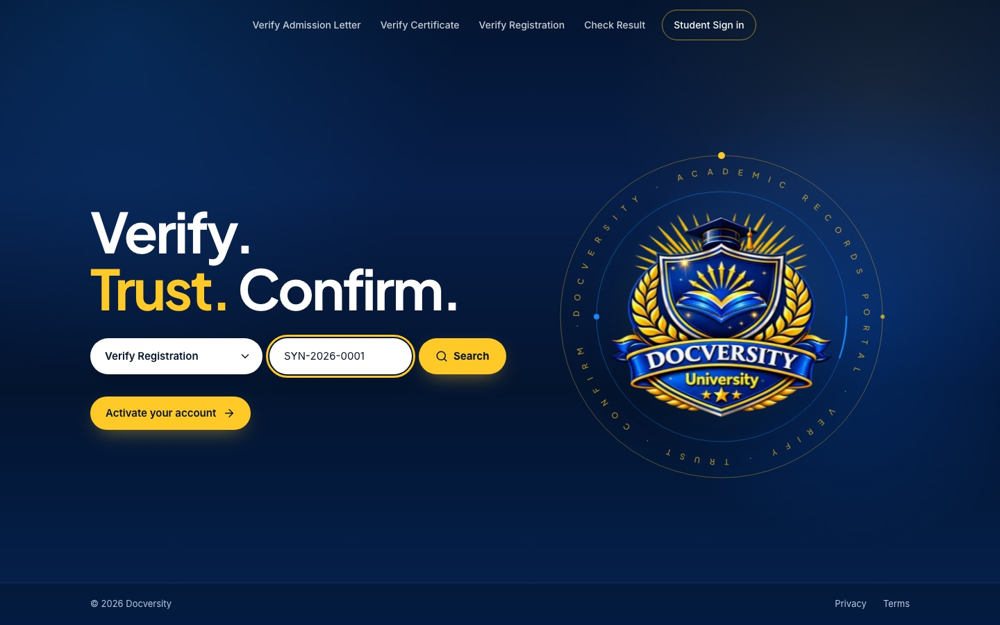
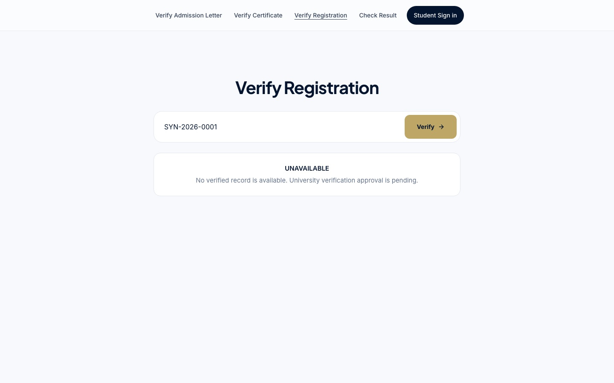
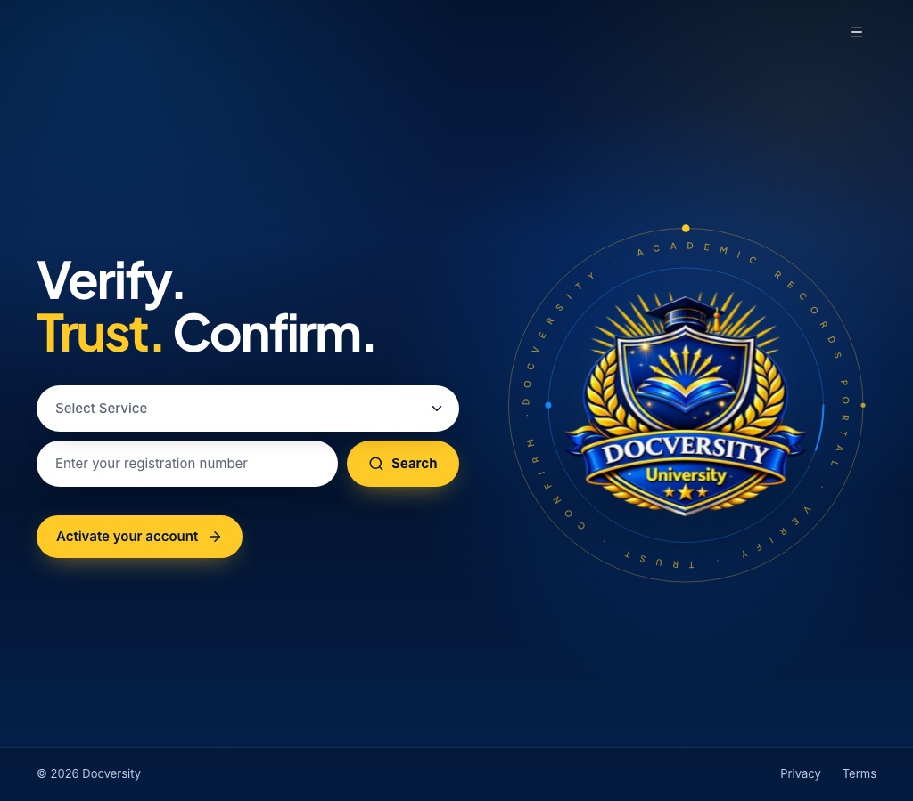
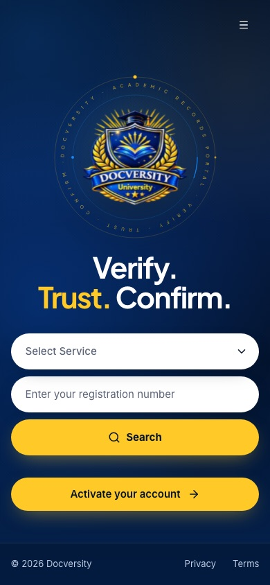
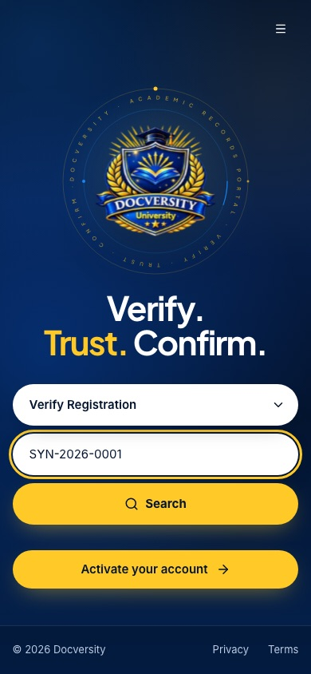
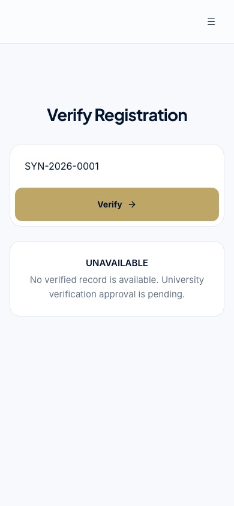

# Homepage service search (mentor request, 2026-11-18)

Requested order in the hero: **Select Service** dropdown, then the **registration number** box, then
**Search**. "Activate your account" stays below. Service options: Verify Certificate, Verify
Registration, Verify Admission Letter, Check Result.

## Behaviour

- Search requires a service and a number (3–128 characters, trimmed), then opens that service's
  existing page (`/verify/certificate`, `/verify/registration`, `/verify/admission-letter`,
  `/results`). The page runs its normal lookup once; the API's policy gate still decides the answer,
  so services without university approval keep returning `UNAVAILABLE`.
- The number never enters a URL. The homepage keeps a one-shot in-memory handoff (service, number,
  timestamp) across the client-side navigation; nothing goes to a URL or browser storage and a reload
  clears it. The service page takes it once and accepts it only for the same service within 60
  seconds. Links such as `#reference=` or
  `?reference=` from elsewhere cannot prefill or trigger a lookup, which keeps the existing
  "unsolicited references are refused" rule.
- Exactly once: read-and-delete runs before the lookup, so reloads, back/forward and development
  remounts do not repeat it. A too-short value is prefilled without a request.
- Native `<select>`, labelled controls, DOM order equals visual order at every width. Between 901 and
  1180 px the service select takes its own row; at 560 px and below the three controls stack.

## Verification (local, production build)

- Unit: 30/30 web test files, 177 tests (new: order, required fields, all four routes, handoff
  consumed once, stale/other-service/malformed/unsolicited-link ignored, short value not sent).
- Browser against `next start` with the verify API stubbed in the browser: all four services at
  1440 px and 390 px reach the right page with exactly one verify POST, reload does not repeat it,
  the number never appears in any request URL, `#reference=` links are ignored, no horizontal
  overflow from 320 to 1440 px, axe: 0 serious/critical on the homepage and result page.
- E2E specs for CI (full stack): `public.spec.ts` hero order, `public-verification.spec.ts` homepage
  search across all four services against the real policy-gated API.

## Screenshots

|                       |                                                                           |
| --------------------- | ------------------------------------------------------------------------- |
| Desktop               |       |
| Desktop, filled       |  |
| Desktop, after Search |       |
| 1024 px               |         |
| Mobile 390 px         |         |
| Mobile, filled        |    |
| Mobile, after Search  |         |
