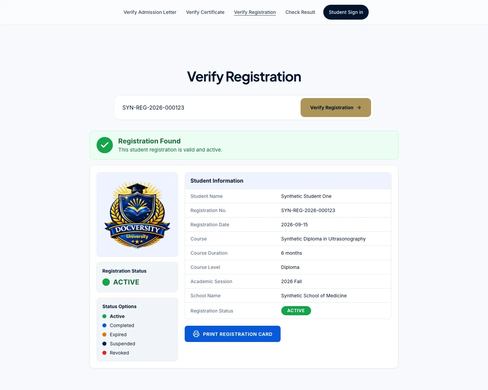
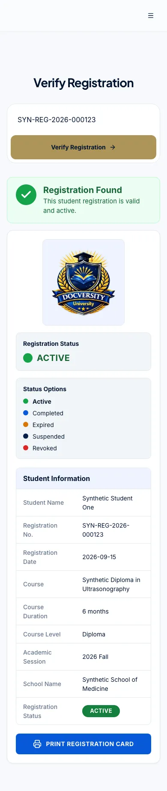
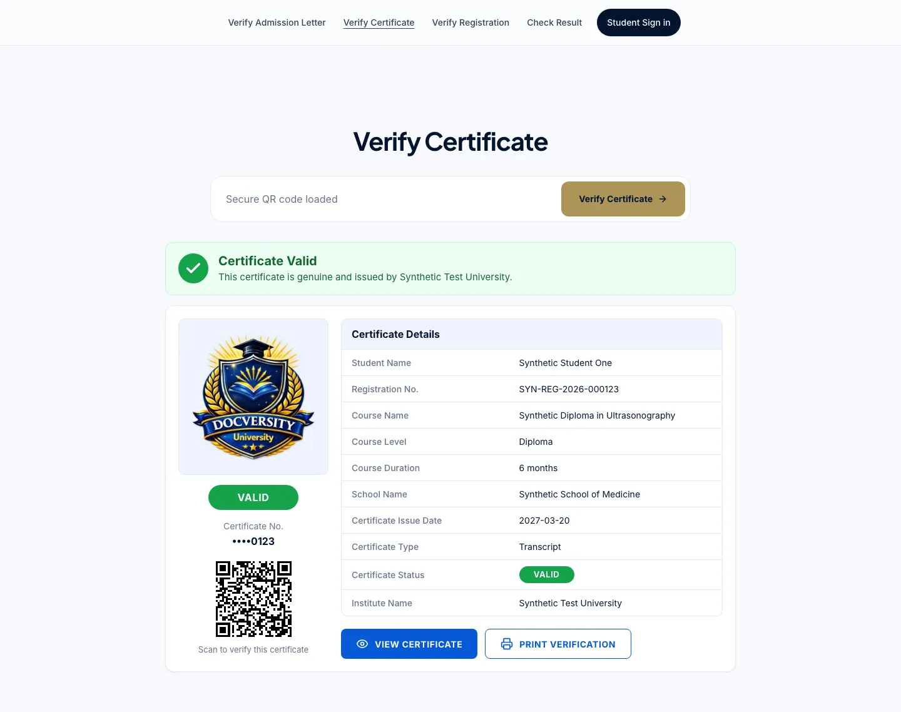
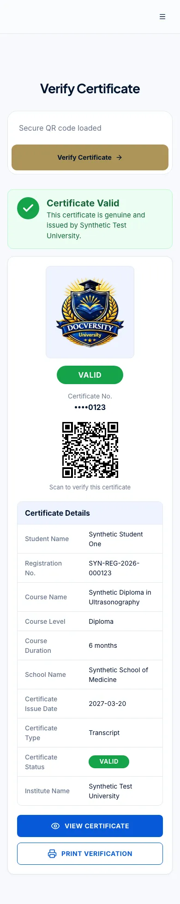
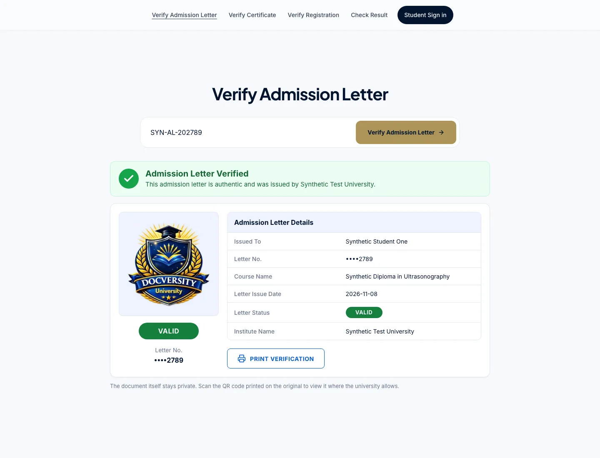
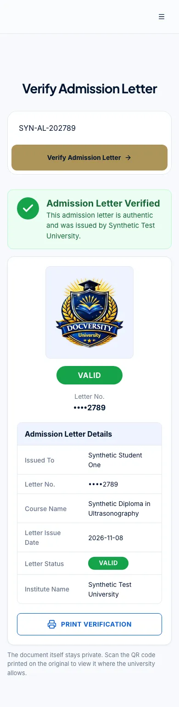
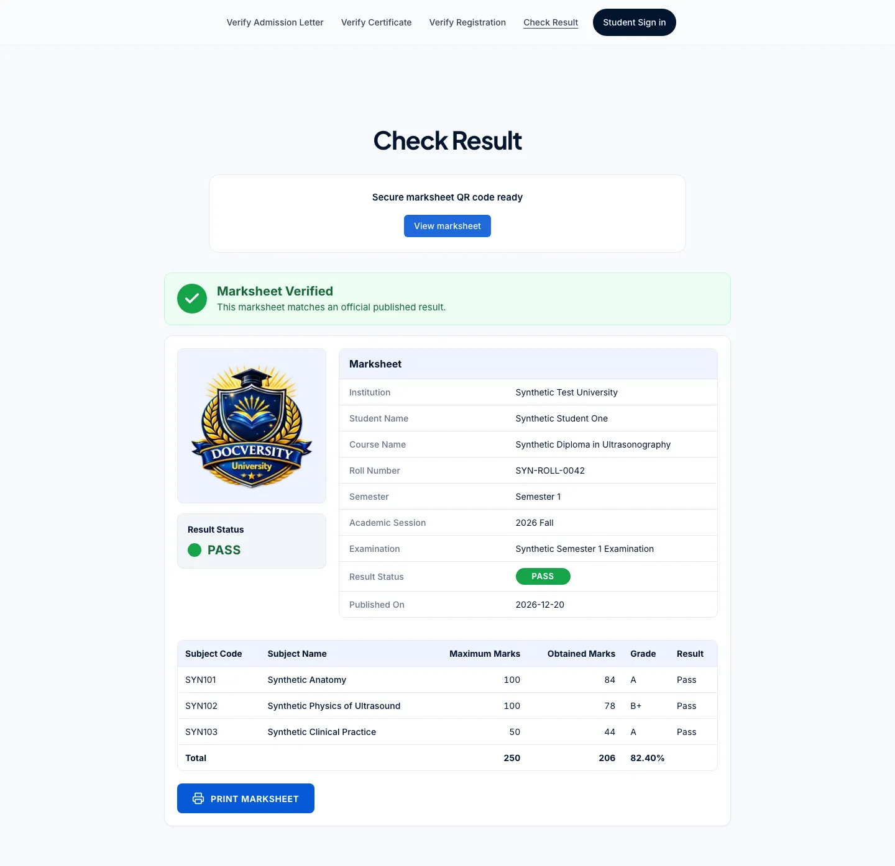
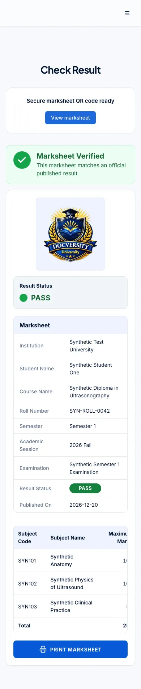

# Public verification portal (mentor-approved UI)

All four homepage services — Verify Registration, Verify Admission Letter, Verify Certificate and
Check Result — accept checks **without a student sign-in**. What a visitor sees is decided by the
server under [ADR-0024](../decisions/ADR-0024-anonymous-public-verification.md).

## Screens (synthetic records, `next start` + mocked API)

| Service                               | Desktop (1440)                                                | Mobile (390)                                                 |
| ------------------------------------- | ------------------------------------------------------------- | ------------------------------------------------------------ |
| Registration Found                    |      |      |
| Certificate Valid (via QR)            |       |       |
| Admission Letter Verified (by number) |  |  |
| Marksheet Verified (via QR)           |            |            |

Differences from the mentor references, on purpose: the student photograph is replaced by the
university crest, and DOB, nationality and national ID rows are never shown (they cannot be
disclosed publicly). The QR code is drawn only when the visitor arrived with the record's QR
credential; a lookup by number never reveals it.

Reusable components (`apps/web/src/features/public-verification/`): `VerificationPageLayout`,
`VerificationSearchForm`, `VerificationStatusBanner`, `VerificationIdentityPanel`,
`VerificationDetailsTable`, `VerificationQRCode`, `VerificationPrintView`, `ResultMarksheetTable`.

## API (all `POST`, JSON body only, rate-limited, `no-store`)

| Route                                             | Purpose                                                            |
| ------------------------------------------------- | ------------------------------------------------------------------ |
| `/public/verify/registration`                     | Registration by number; anonymous details only where approved      |
| `/public/verify/admission-letter`, `/certificate` | By number or QR token; approved details; `documentAccess`          |
| `/public/verify/document`                         | Issued PDF for the QR-token holder, where approved                 |
| `/public/verify/result-options`                   | Courses (and real semesters/years) open to anonymous result search |
| `/public/verify/result-search`                    | Course + roll number + semester → published status only            |
| `/public/verify/result-marksheet`                 | Full marksheet for the marksheet QR-token holder, where approved   |
| `/public/verify/result`                           | Signed-in owner (unchanged), now with the marksheet QR link        |

## University disclosure-approval checklist

Nothing below is enabled in production today: the 12 approved policies (CDS, CUT, CUSG) carry no
`publicDisclosure` block, so anonymous checks answer exactly as before. Each row needs a written
university decision and then a policy proposal and approval by **two independent, authorized
people**. Admin and Admin2 must not be treated as independent until the university confirms who holds
Admin2 (see the open governance follow-up).

| Service          | Decision needed                                                                  | Fields that can be authorised                                                                                                                 | Never available                                                            |
| ---------------- | -------------------------------------------------------------------------------- | --------------------------------------------------------------------------------------------------------------------------------------------- | -------------------------------------------------------------------------- |
| Registration     | Allow checks without sign-in, per course                                         | Student name, registration number, registration date, course name, level, duration, school, academic session, admission date, completion date | Photo, DOB, nationality, ID/PAN/passport numbers, contact details, uploads |
| Admission letter | Allow anonymous details; allow PDF to QR holders                                 | Student name ("Issued to"), registration number, course name, level, duration, school, issue date                                             | as above                                                                   |
| Certificate      | Allow anonymous details; allow PDF to QR holders                                 | Student name, registration number, course name, level, duration, school, issue date, certificate type                                         | as above                                                                   |
| Result           | Allow course + roll + semester status checks; allow full marksheet to QR holders | Course, academic session, result outcome (PASS/FAIL)                                                                                          | Marks without the marksheet QR; unpublished or withdrawn results           |

Also needed before go-live:

- Confirm the authoritative **roll number** field (`registrations.roll_reference_number`) is filled
  for every student who should be searchable; an ambiguous roll number never resolves.
- Confirm the institution name printed in banners (`institutionName` in each policy).
- Decide whether a student photograph may ever be shown publicly (not implemented).
- Confirm independent policy approvers (the Admin2 question) and MFA for SUPER_ADMIN accounts.

## Production activation and withdrawal (no code change, no data edits)

The homepage services already call the anonymous verification API. Until a course's **latest
approved** policy for a service carries `publicDisclosure`, Verify Registration answers "Sign in
required" (`official-verification.service.ts`, `anyAnonymous('registration')`) and the other services
show only validity, never details. Activation is a university action in the Admin Panel, never a
database or JSON edit:

1. Record the written university decision for the service and course (the table above): which
   fields, and whether QR holders may open the PDF or full marksheet.
2. Proposer (`verificationPolicies.manage`): Admin → Official records → Policies → choose the
   service and course; re-enter the institution name and authorization reference (a new policy fully
   replaces the current one); tick "The university authorizes checks without a student sign-in for this course", the approved fields only, and the
   credential option if approved; submit. A proposal (DRAFT) discloses nothing.
3. Approver: a **different**, university-confirmed person approves the DRAFT. The API refuses
   self-approval and refuses approval while `OFFICIAL_VERIFICATION_ENABLED` is off. The proposal and
   approval are audited (`VERIFICATION_POLICY_CHANGED` with PROPOSE / APPROVE, IDs only).
4. Check with a synthetic or consenting record that only the approved fields appear.

To **withdraw public access**, propose and approve a superseding policy for the same service and
course **without** the anonymous option. Do not use "Withdraw" on the current policy for this: the
next-latest approved policy then applies again, and it may itself carry an older disclosure.
Issued documents keep their validity, which follows the policy they were issued under.

Never add photo, date of birth, nationality, identity numbers, contact details or uploads to the
allowlists; they need a separate legal and privacy decision and a reviewed code change.

## Tests

- API: `apps/api/test/public-verification/acceptance.test.ts` steps B1–B4 (allowlists, no oracle,
  credential-gated PDF and marksheet, status-only result search) plus A15–A17 (revocation,
  withdrawal, status-aware wording).
- Web: `apps/web/test/public-verification.test.tsx` (all four result screens, QR, View/Print,
  Check Result form, safe errors, handoff).
- Browser: `official-verification`, `public-verification`, `public-verification-acceptance`,
  `public` Playwright specs.
