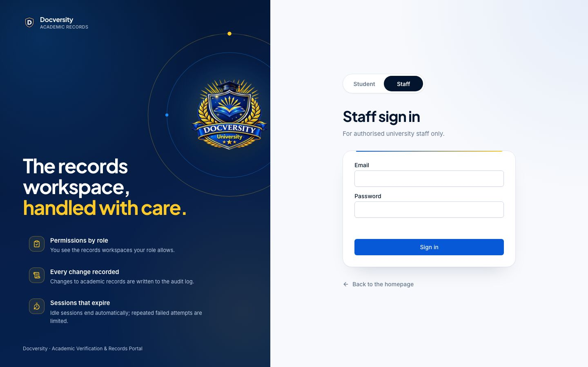
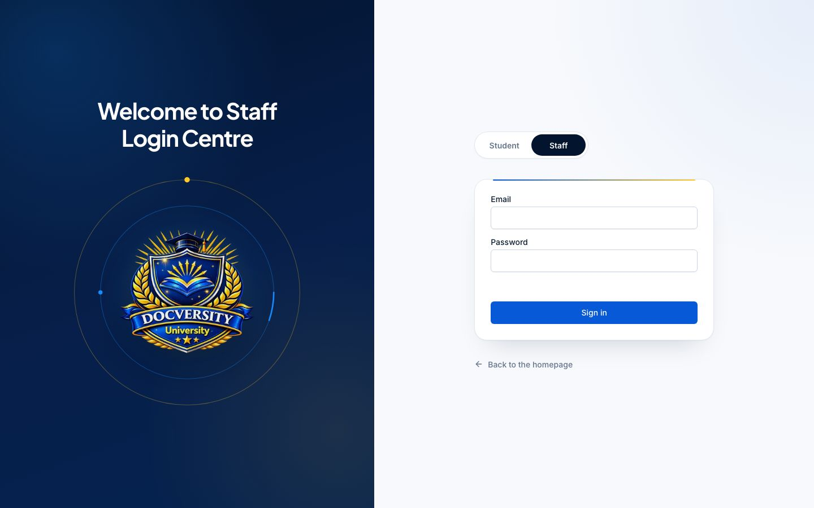
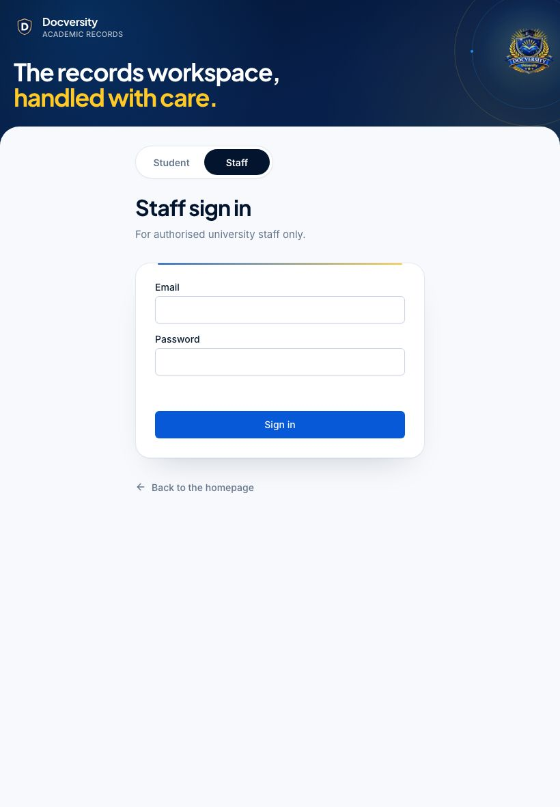
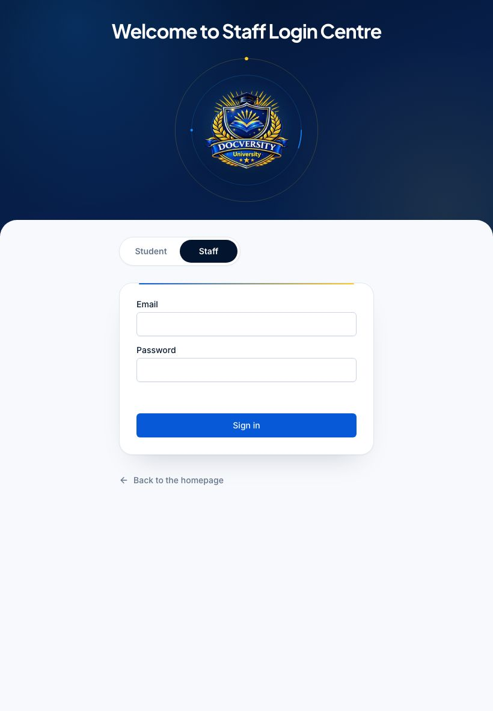
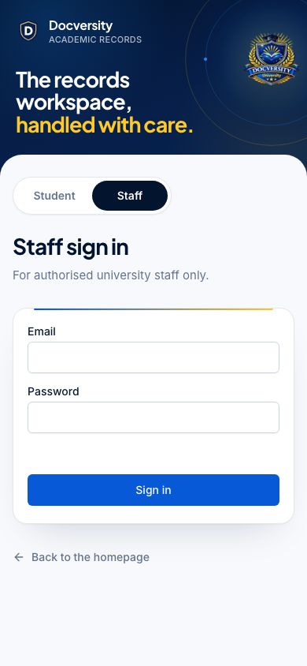
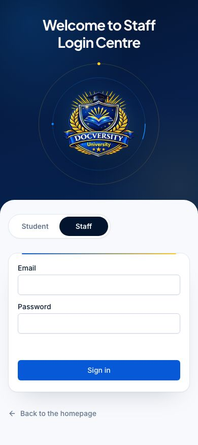

# Staff Login Centre (2026-11-18)

`/admin/login` now uses the student sign-in layout: the navy brand panel with one centred heading,
**Welcome to Staff Login Centre**, above the Docversity crest, and the light form side with the
Student/Staff switch and the form card. The old staff statement, highlights, wordmark, footer, form
title ("Staff sign in") and description were removed. The heading is the page's only `h1`.

The old design came from the page itself (`app/admin/login/page.tsx` passing staff copy to the shared
`AuthShell`), not from cached assets or a deployed image. `AuthShell` now renders staff pages in the
student layout; the activation page keeps its own layout. The staff step pages (`/admin/login/verify`,
`/admin/security/password`, `/admin/security/mfa`) use the same frame and keep their titles,
descriptions and step instructions; the verify step shows the Staff Login Centre heading.

No authentication, session, MFA, recovery-code, password-change, lockout or permission code changed:
the diff touches only `AuthShell`, its CSS, two page files and tests.

## Verification (local production build, mocked API for page states)

- Web unit: 31/31 files, 181 tests (new `test/staff-auth-visual.test.tsx`: single `h1`, only the crest
  and heading in the brand panel, removed copy absent, form/labels/switch present, unavailable notice).
- Browser at 1440/820/390 px: axe 0 serious/critical and no horizontal overflow on `/admin/login`, the
  three staff step pages and the student pages; keyboard order switch → Email → Password → Sign in →
  Back; required fields block empty submit; the API error message renders in the form.
- Student sign-in and activation screenshots are byte-identical before and after.
- e2e `admin-auth.spec.ts` asserts the new heading and the removed copy (CI runs the full stack).

## Screenshots

| Before                                                                      | After                                                                     |
| --------------------------------------------------------------------------- | ------------------------------------------------------------------------- |
|  |  |
|    |    |
|    |    |
