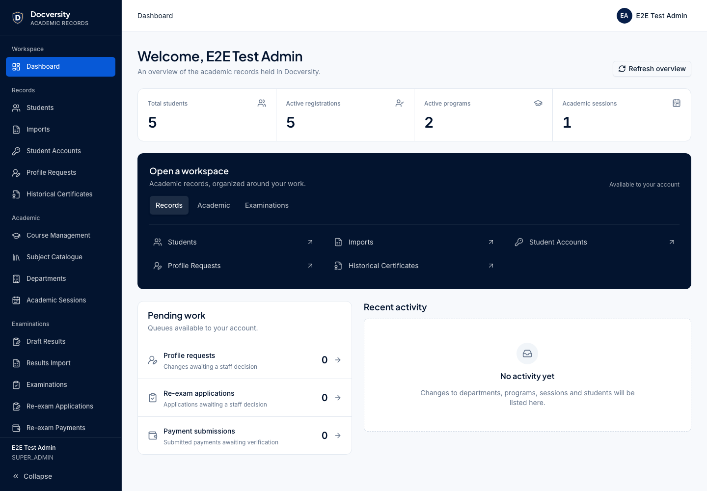
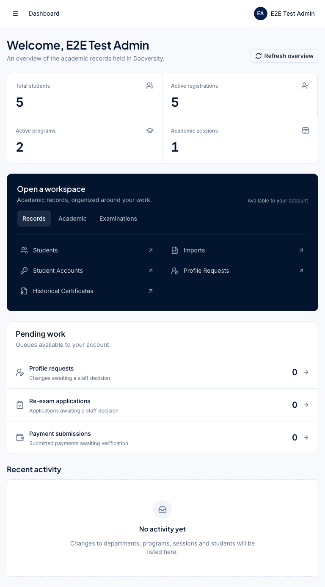
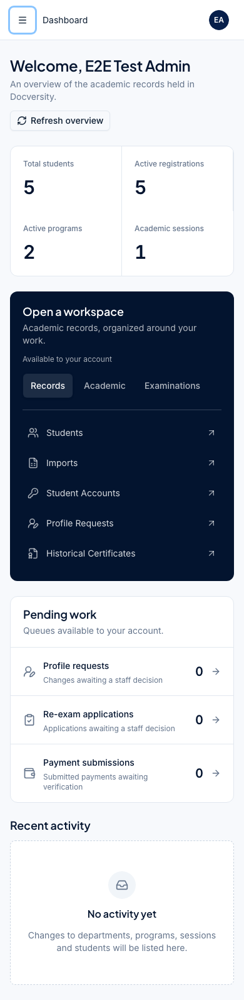
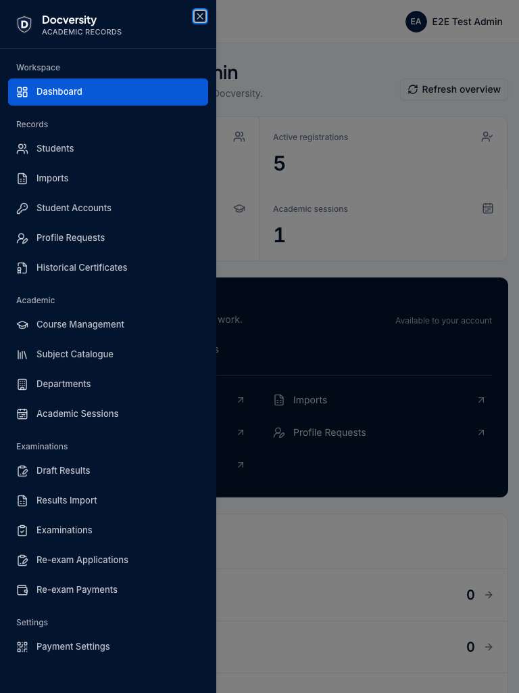
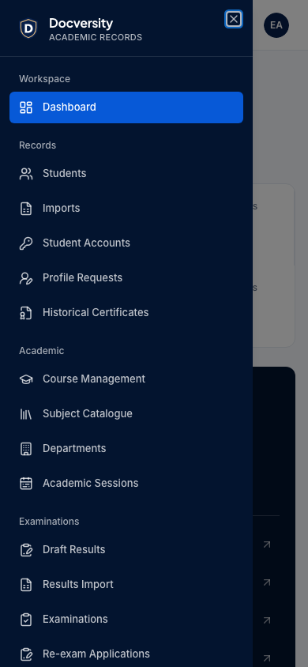

# UI-02 — Final visual review

Final visual approval received on 11 October 2026 after review of desktop, tablet, mobile and the mobile navigation drawer. The implementation is preserved. Quality gates, commit, push and draft PR delivery are authorized; automatic merge remains excluded.

These are the existing verified captures of the current implementation. They show synthetic test accounts and API-backed test records. Production pending counts use existing authorized APIs, with permission filtering before requests; loading and errors do not substitute invented counts. GSAP transitions remain bounded to 240ms and are skipped for reduced motion.

## Desktop — 1440px, expanded sidebar

## Tablet — 768px

## Mobile — 390px

## Tablet navigation drawer — 768px

## Mobile navigation drawer — 390px

